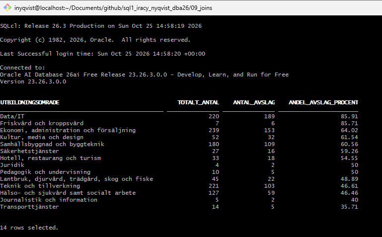
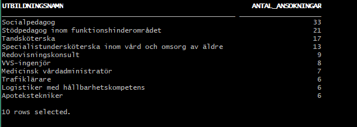
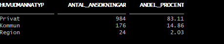
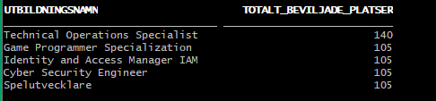

# The Skool - Datadriven analys av YH-ansökningar 2025

Detta projekt är en del av kursen i SQL och databashantering. Syftet är att analysera data från Myndigheten för yrkeshögskolan (MYH) för att hjälpa utbildningsanordnaren **The Skool** att fatta datadrivna beslut inför framtida ansökningar.

## Innehåll

- `ansokningar_2025.csv` – Extraherad data från Tabell 3 (MYH:s ansökningsomgång 2025).
- `extract_table3.py` – Python-skript som extraherar rätt flik från Excel-filen.
- `1_load_data.sql` – SQL-skript för att skapa tabellen `ANSOKNINGAR` och ladda in CSV-datan.
- `2_eda.sql` – SQL-frågor för grundläggande EDA (Uppgift 1).
- `3_datadrivna_beslut.sql` – Egna analysfrågor (Uppgift 3).
- `uppgift_2_intervju.md` – Anteckningar från intervjun med domänexpert.

## Hur man kör projektet

1. Starta databasen: `oracle start`
2. Ladda in data: `podman exec -i -w /scripts sqlcl sql system/"$ORACLE_PWD"@oracle-free:1521/FREEPDB1 < 1_load_data.sql`
3. Kör EDA: `... < 2_eda.sql`
4. Kör egna frågor: `... < 3_datadrivna_beslut.sql`

## Insikter från analysen

- **Data/IT** har högst andel avslag (ca 86%), vilket gör det till ett konkurrensutsatt område.
- **Privata aktörer** dominerar marknaden (ca 83% av alla ansökningar).
- De vanligaste utbildningarna är **Socialpedagog**, **Stödpedagog** och **Tandsköterska**.
- Inom Data/IT har utbildningar som *Technical Operations Specialist* och *Game Programmer Specialization* flest beviljade platser.

## Reflektion

Analysen visar att det är viktigt att titta på specifika delområden inom Data/IT, eftersom hela området inte är mättat. Intervjun med domänexperten bekräftade också att distansutbildning kan vara en strategisk fördel för just Data/IT.

## Verktyg

- Oracle Database (via Podman)
- SQLcl
- Python (pandas, openpyxl)
- Git & GitHub

## Insikter från analysen

Här är några av resultaten från analysen:

### 1. Avslagsprocent per utbildningsområde
Data/IT har högst andel avslag (ca 86%), vilket gör det till ett konkurrensutsatt område.

### 2. Antal ansökningar per utbildningsnamn
De vanligaste utbildningarna är Socialpedagog, Stödpedagog och Tandsköterska.

### 3. Fördelning mellan olika huvudmän
Privata aktörer dominerar marknaden (ca 83% av alla ansökningar).

### 4. Utbildningar med flest beviljade platser (Data/IT)
Technical Operations Specialist och Game Programmer Specialization har flest beviljade platser.

## Användning av LLM
Jag har använt LLM som bollplank för att förstå vissa SQL-koncept och felsöka felmeddelanden. All kod är dock skriven och förstådd av mig.

